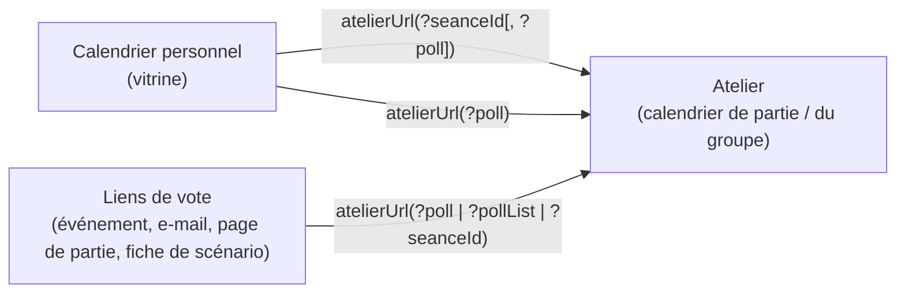
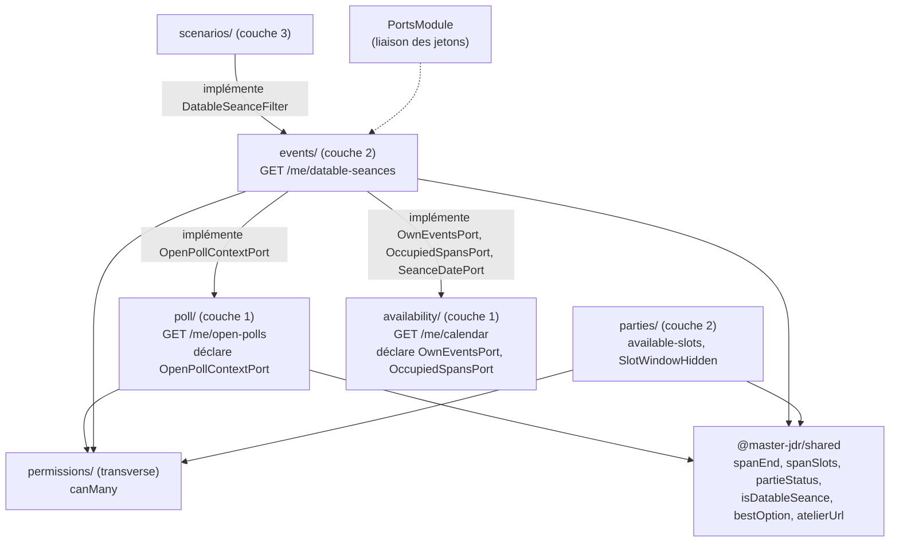
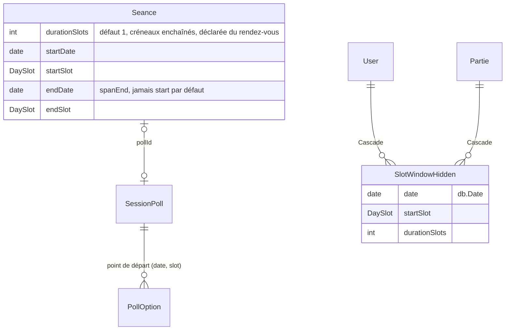

# Architecture Spine — Palier 10.4 : Sondage et Destinée dans le calendrier

`PL-1` désigne les **plages longues**, ajoutées au périmètre pendant l'architecture ; le PRD amendé le 2026-10-20 les porte sous ce nom (§4.10, FR-19 à FR-23), avec l'échéance (FR-18). Un delta UX reste requis avant leurs stories (voir Open Questions).

## Design Paradigm

**NestJS Modular + Angular Signals (brownfield), trois couches et ports hérités du Palier 10 (P10-AD-1).** Ce palier n'ajoute aucune couche. Il fixe le **partage des rôles entre calendriers** :

| Calendrier | Route | Rôle |
| --- | --- | --- |
| De partie, MJ | `/parties/:id/calendar` | **atelier** : Destinée, plateau nominatif, vote, fixer la date, **composer**, fenêtres de l'automate |
| De partie, joueur de JDR | `/parties/:id/guild-calendar` | atelier sans action d'organisateur : Destinée, plateau nominatif, vote |
| Du groupe / de la soirée isolée | `/parties/:id/guild-calendar` | **atelier** : Destinée, plateau nominatif, vote ; pour l'organisateur : composer, fixer, prolonger |
| Personnel | `/profile/calendar` | **vitrine** : Destinée sur toutes les parties actives, plateau **anonyme**, vote, fixer, prolonger ; **aiguille** vers l'atelier pour composer ou voir des noms |



Dépendances des nouvelles lectures (flèche = « peut dépendre de » ; la liste blanche de `ports/layer-imports.spec.ts` reste la garde) :



## Inherited Invariants

Les AD-1 à AD-18 de la spine du Palier 10 (cités **P10-AD-n**) et ses invariants hérités (P1 à P9) s'appliquent tels quels. Ceux que ce palier touche directement :

| Inherited | From parent | Binds here |
| --- | --- | --- |
| P10-AD-1 | Palier 10 | Couche 1 n'importe jamais au-dessus ; besoin d'une donnée de couche 2 → port déclaré dans le module demandeur, lié dans `PortsModule` ; une table, un écrivain |
| P10-AD-4 | Palier 10 | Plage de la `Seance` seule source de la date — **son Deferred « plages longues : Palier 10.4 » est comblé par AD-10, AD-11, AD-14** |
| P10-AD-6 | Palier 10 | `PermissionService` seul juge ; aucun code ne lit `ownerId` / `hostId` pour décider d'un droit — fonde `can` (AD-4) |
| P10-AD-10 | Palier 10 | Précédent du masquage relationnel côté serveur (AD-7) |
| P10-AD-13 | Palier 10 | `notifyPartieSignalsChanged` → `user:{id}` de `membersOf` après toute mutation visible en liste (AD-12) |
| P10-AD-15 | Palier 10 | **Étendu par AD-14** : `OccupiedSpan` devient une plage ; les lecteurs déplient la plage entière |
| P10-AD-18 | Palier 10 | **Déplacé par AD-15** : la fonction unique de statut devient une fonction pure de `@master-jdr/shared`, sans changer ses règles |
| P9-AD-9 | Palier 9 | Calendrier personnel anonyme : aucune identité de votant n'y transite (AD-2, AD-6) |
| P9-AD-18 | Palier 9 | **Amendé par AD-1** : `/me/calendar` reste l'unique lecture du calendrier personnel **bornée par période** |
| P9-AD-20 | Palier 9 | Comptes et « qui manque » dérivés côté écran à l'atelier — **restreint par AD-4 pour les droits**, qui sont servis |
| Story 36.9 | Épic 36 | Destinée = mode, pas couche : hors `activeLayers` / `CALENDAR_LAYER_KEYS`, état keyé par `pollId` |
| P7-AD-2, P7-AD-4 | Palier 7 | `emit(topic)` après validation, hors transaction ; `notifyChanged()` sur tout service front rafraîchissable |

## Invariants & Rules

### AD-1 — Calendrier personnel : trois lectures, une par nature [amende P9-AD-18]

- **Binds:** FR-5, FR-7, FR-8, FR-15
- **Prevents:** des sondages servis à la fois par `/me/calendar` (bornés au mois, sans les groupes) et par une seconde lecture (non bornée, groupes inclus), qui divergent dès le premier sondage de groupe ; une liste ✦ ramenée au mois affiché.
- **Rule:** Le calendrier personnel lit **exactement** : `GET /me/calendar` (dispos, séances, inscriptions ouvertes, **bornés par période**) ; `GET /me/open-polls` (AD-2) ; `GET /me/datable-seances` (AD-3). La clé `votes-en-cours` **quitte** `MeCalendarDto`, qui cesse d'être indexé par couche (caractérisation de la Story 30.5 mise à jour dans la même story) ; la clé de couche `votes-en-cours` reste dans `CALENDAR_LAYER_KEYS` et gouverne l'affichage des entrées d'option quelle que soit leur source. `allCalendarEntries()` contient **tous** les sondages ouverts, sans borne ; la période ne filtre que le rendu de la grille. Le filtre anti-spoil (`VISIBLE_POLL_WHERE`) suit les sondages dans `/me/open-polls`. Côté web, le service unique des sondages ouverts reste `OpenPollsService`, réalimenté par `/me/open-polls` (plus d'appel par partie) ; aucun second service.

### AD-2 — `GET /me/open-polls` : sondages ouverts, toutes familles, anonymes

- **Binds:** FR-7, FR-8, FR-9, FR-11, FR-12
- **Prevents:** une identité de votant dans le calendrier personnel ; un vote personnel qui ne sait plus montrer sa propre réponse ; deux dénominateurs ou deux définitions de « a répondu » entre la vitrine et l'atelier ; un appel par partie.
- **Rule:** Route servie par `poll/` (couche 1, écrivain de `SessionPoll`). Périmètre : sondages `OPEN` des parties **actives** (AD-15) du lecteur, **toutes familles**, échéance passée ou non, hors parties masquées. Les données de couche 2 arrivent par `OpenPollContextPort` (AD-15). Par sondage : `pollId`, `partieId`, nom de la partie, `family`, `kind`, `seanceId`, titre du rendez-vous, `expiresAt`, `durationSlots` (racine), options (`optionId`, `date`, `slot`, `yes`, `maybe`, `no`, **`myAnswer`**), `eligibleCount`, `answeredCount`, `me = { eligible, answered }` et `can` (AD-4). **Aucun `userId` de votant** ; `myAnswer` est la réponse du seul lecteur. Ayants droit : **une** fonction `pollVoters()` de `events/` (JDR : MJ + membres, ce que comptait `membersCount` ; ralliement : `eligibleVoters`, P10-AD-6). « A répondu » : **une** fonction pure `hasAnswered()` de `@master-jdr/shared`, qui garde la règle de chaque famille (JDR : toutes les options ; ralliement : au moins une) et que réutilisent `getMissingVoters`, `respondentIds`, les signaux de liste et les plateaux. `eligibleCount` remplace `membersCount` comme dénominateur.

### AD-3 — Rendez-vous à dater et rendez-vous composables : deux prédicats partagés

- **Binds:** FR-2, FR-5, FR-10, FR-14
- **Prevents:** trois calendriers qui n'affichent pas « Proposer des dates » pour les mêmes rendez-vous ; un choix du rendez-vous de FR-2 qui oublie les séances à sondage ouvert ; une couche 2 qui importe le scénario.
- **Rule:** **Rendez-vous = `Seance`**, dans les deux familles. **À dater** = `Seance` sans date, **sans sondage lié** (`Seance.pollId` vide), d'un événement non annulé, d'une partie active (AD-15), avec `can.propose`. En JDR : toute séance d'un scénario non clôturé ; **en ralliement : seule la soirée isolée en attente de date** (un événement de groupe naît daté ou avec sondage). **Composable** = à dater, **ou** porteur d'un sondage ouvert avec `can.edit`. Les deux prédicats `isDatableSeance()` et `isComposableSeance()` vivent dans `@master-jdr/shared` et servent les trois calendriers ; « Proposer des dates » utilise le premier, le choix du rendez-vous ouvert depuis une fenêtre de l'automate (FR-2) le second. `GET /me/datable-seances` est servie par `events/` ; l'exclusion du scénario clôturé est fournie par `scenarios/` via le jeton `DatableSeanceFilter`, déclaré dans `events/ports/` et lié dans `PortsModule`. Réponse par séance : `seanceId`, `partieId`, nom de la partie, `family`, `kind`, titre du rendez-vous. À l'atelier, la liste se dérive de la charge utile déjà chargée, avec les mêmes prédicats.

### AD-4 — Droits d'organisateur : un objet `can`, servi, résolu sur la cible exacte

- **Binds:** FR-5, FR-7, FR-10, FR-11
- **Prevents:** un bouton « Fixer la date… » montré à tout membre d'un groupe puis refusé (la règle « hôte » ne joue que sur une cible `{ eventId }`) ; un « Proposer des dates » jamais visible en soirée (`SEANCE_POLL_CREATE` y vaut `NOBODY`) ; un « Prolonger » montré au MJ puis refusé ; un front qui compare `hostId` à l'utilisateur.
- **Rule:** Toute charge utile qui commande une action d'organisateur porte `can = { propose, edit, choose, extend }`, calculé par **une** nouvelle méthode `PermissionService.canMany(userId, action, targets)` qui applique toutes les règles d'`assert` (cellule, `HOST_ONLY_WHEN_EVENT_TARGETED`, capacité) sur des cibles `{ seanceId }` ou `{ eventId }`, **jamais `{ partieId }` seule**, en un nombre fixe de requêtes. Correspondance, tenue dans `permissions/` :

  | Famille | `propose` | `edit` | `choose` | `extend` |
  | --- | --- | --- | --- | --- |
  | JDR | `SEANCE_POLL_CREATE {seanceId}` | `POLL_OPTIONS_SET` | `POLL_CHOOSE` | `POLL_EXTEND` (refusé) |
  | Ralliement | `EVENT_UPDATE {eventId}` | `EVENT_UPDATE {eventId}` | `POLL_CHOOSE {eventId}` | `POLL_EXTEND {eventId}` |

  Portent `can` : `OpenPoll`, `DatableSeance`, `EventCardDto` et le DTO de séance de l'atelier JDR. Le `canCompose` du calendrier du groupe (`hostId === me`) bascule sur `can` dans la story qui touche cet écran. En JDR, `extend` reste refusé : le MJ prolonge en modifiant l'échéance (`edit`, AD-17). Écrire la durée n'a pas d'action propre : elle suit l'action de la route qui la porte (`SEANCE_POLL_CREATE`, `POLL_OPTIONS_SET`, `EVENT_UPDATE`, ajout ou modification de séance). Test : pour chaque famille et action, `canMany(...) === true` ⇔ l'écriture correspondante ne renvoie pas 403.

### AD-5 — Le composer n'existe qu'à l'atelier, armé par `?seanceId`

- **Binds:** FR-2, FR-5, FR-6, FR-10, FR-14
- **Prevents:** un second composer dans le calendrier personnel ; l'ancien panneau de création (Story 8.7) et le composer qui cohabitent ; un rechargement qui réarme un composer déjà validé ; un composer neuf ouvert sur une séance déjà liée (400 à l'envoi).
- **Rule:** Le composer (création **et** modification) n'est rendu qu'à l'atelier, pour qui a `can.propose` ou `can.edit`. Son **seul armement par l'adresse** est `?seanceId=<id>` : la page résout la séance dans sa charge utile ; si `isDatableSeance` est vrai, composer vide (ou avec la fenêtre qui l'a déclenché) ; si elle porte un sondage ouvert et `can.edit`, composer **prérempli** (options, échéance) ; dans les deux cas, la durée du composer s'initialise **toujours** à `Seance.durationSlots` ; dans tout autre cas, calendrier normal et message écrit, sans rien révéler de la séance. L'armement ne dépend jamais du mode de la route. Le panneau `app-poll-creation` / `pollPanelOpen` (Story 8.7) est **retiré** dans la story de FR-14. `?seanceId` est retiré de l'adresse à la validation comme à l'annulation ; la validation pose `?poll=<pollId>` (renvoyé par les deux écritures) et on reste à l'atelier, Destinée active. « Modifier les dates » depuis la vitrine navigue avec `?seanceId` **et** `?poll`. Écritures : JDR = `POST /scenarios/seances/:id/poll` puis `PUT /parties/:id/poll/:pollId/options` ; soirée isolée = `PATCH /parties/:id/events/:eventId` (Story 41.2, remplacement complet, les autres champs relus depuis la carte de l'événement) ; modification d'un sondage de groupe = chemins de la Story 40.5b. L'aller-retour de création d'une conjonction est conservé ; son brouillon porte `durationSlots` **dans les deux sens** (le composer s'initialise depuis le brouillon, `finishCompose` rend créneaux et durée). Le choix du rendez-vous a lieu **avant** le composer ; `ComposeConfirmDialog` ne garde que l'avertissement de perte de réponses, calculé par **une** fonction pure de `features/calendar/` selon le critère du serveur : si la durée diffère de `Seance.durationSlots`, **toutes** les réponses sont comptées, sinon celles des options retirées ; la même fonction sert à la revérification avant l'écriture.

### AD-6 — Destinée : un `pollId`, adressable, une seule entrée, une seule fin

- **Binds:** FR-7, FR-8, FR-9, FR-12, FR-13, FR-14
- **Prevents:** une Destinée ou un créneau courant keyés par un rang, qui basculent après un rechargement SSE ; une Destinée ouverte en vue Agenda sur mobile, où elle n'existe pas ; trois calculs du créneau d'entrée ; une fin de mode indétectable dans la vitrine ; des noms de votants dans la vitrine.
- **Rule:** L'état reste `destinyPollId` ; le **créneau courant** est un `optionId`, et n/N se dérive de l'ordre chronologique des options. `?poll=<pollId>` est **le** paramètre de la Destinée dans les trois calendriers ; `?pollList` ouvre la liste ✦ (restreinte à la partie à l'atelier). Ils sont lus à l'initialisation puis réécrits par `Location.replaceState`, **sans navigation du routeur** (une navigation vide le bandeau contextuel), à chaque entrée, changement ou sortie. **Toute entrée** (lien, liste, après validation) force la vue Mois (Semaine si la famille du sondage est `ralliement`), replie le tiroir mobile et se place sur `destinyEntryOption(poll, today)` (premier créneau à venir avant l'échéance, `bestOption` après). Les flèches parcourent les options ; changer de sondage passe par la liste. **Fin** : à l'atelier, sondage absent de la charge utile rechargée → sortie, raison lue dans la charge utile (séance datée → date fixée ; événement annulé → annulé ; sinon générique) ; dans la vitrine, absence de `/me/open-polls` après un rechargement **réussi** → sortie avec un message neutre unique (l'heuristique `lastDestinyDates` est retirée). L'échéance passée ne ferme pas. `?poll` inconnu ou clos : calendrier normal, message écrit une fois, paramètre retiré ; atelier d'une partie inaccessible : refus habituel de la page. Si le créneau courant disparaît d'un sondage toujours présent (options recréées), la Destinée se replace par `destinyEntryOption`. **Plateau** : à l'atelier, comptes dérivés côté écran (P9-AD-20) et absents nommés **pour l'organisateur seulement** (règle actuelle de la Story 36.12 et du Palier 10), nombre pour les autres ; dans la vitrine, comptes servis et **nombre** d'absents (`eligibleCount − answeredCount`), avec un lien `atelierUrl(?poll)` pour l'organisateur, jamais de noms. Le plateau est un composant nouveau, qui ne modifie ni ne remplace les deux surfaces de `PollStatusPanel` de la fiche de scénario.

### AD-7 — Fenêtres de l'automate : masquage relationnel, ordre de calcul fixé

- **Binds:** FR-1, FR-2, FR-3
- **Prevents:** un masquage local qui réapparaît sur un autre appareil ; une liste qui rétrécit à chaque masquage parce que le plafond s'applique avant ; un joueur qui écrit des masquages ; deux sémantiques de « libre » entre une fenêtre d'un créneau et une de N.
- **Rule:** Table `SlotWindowHidden(userId, partieId, date @db.Date, startSlot, durationSlots)`, unique sur les cinq colonnes (index nommé court par `map:`), écrivain `parties/`, `onDelete: Cascade` sur l'utilisateur et la partie. `GET /parties/:id/available-slots`, dans cet ordre : calcul des fenêtres de `span` créneaux (AD-11) → **exclusion** de celles qui coïncident (même départ, même durée ; un sondage sans séance vaut 1) avec une option d'un sondage ouvert de la partie → séparation des masquées du lecteur → **plafond** (20, inchangé) sur les seules visibles ; les masquées sont renvoyées à part, marquées `hidden`. Exclusion et masquage ne valent **que dans la vue nominative du MJ** : la vue agrégée des joueurs (Story 30.6) est inchangée. Chaque fenêtre servie porte son `durationSlots` ; masquer ou démasquer recopie celui de la fenêtre, jamais `?span`. Masquer / démasquer = `PUT` / `DELETE` sous `parties/:id/available-slots/hidden`, nouvelle action `SLOT_WINDOW_HIDE` (`OWNER_ONLY` en JDR, `NOBODY` en ralliement, test de refus), corps validé (`DaySlot`, date non passée, `durationSlots` ≤ plafond partagé, 400 en français). Les lignes passées sont ignorées à la lecture.

### AD-8 — Fenêtres côté écran : une dérivation, une durée

- **Binds:** FR-1, FR-2, FR-22
- **Prevents:** une colonne et une grille qui ne s'accordent pas sur les fenêtres déjà prises ; une fenêtre d'un créneau versée dans un sondage de trois.
- **Rule:** La colonne affiche les fenêtres servies **moins** les cellules du composer ; une **seule fonction pure** de `features/calendar/` le calcule ; la sélection d'une fenêtre est un signal éphémère, jamais une couche. La colonne demande `?span` = valeur **courante** du champ durée du composer (initialisée à `Seance.durationSlots`, AD-5), 1 hors composer. Une fenêtre ne s'ajoute à un sondage qu'à durée égale à cette même valeur ; une fenêtre choisie avant le rendez-vous (FR-2) et d'une autre durée n'est pas versée : le composer s'ouvre à la durée du rendez-vous, sans elle, avec un message écrit.

### AD-9 — Filtre par partie et repli de colonne : état de navigation, côté client

- **Binds:** FR-4, FR-15
- **Prevents:** un filtre qui vide l'estompe, les indisponibilités ou la liste ✦ ; une préférence de compte ajoutée pour un état de navigation ; un filtre glissé dans `CALENDAR_LAYER_KEYS`.
- **Rule:** Le filtre par partie (vitrine) est un signal de la page, **non persisté**, appliqué **en aval** d'`allCalendarEntries()` comme les couches ; estompe, rail, indisponibilités, liste ✦, puce et plateau dérivent de la liste non filtrée ; les dispos ne sont jamais filtrées. Entrer en Destinée sur une partie décochée la recoche et allume la couche `votes-en-cours`. L'état replié / docké de la colonne de droite est **retenu dans le navigateur** (`localStorage`, lecture et écriture sous `try/catch`, ouvert par défaut), une clé pour toutes les colonnes de droite, aucune colonne en base ; entrer en Destinée ouvre la colonne.

### AD-10 — Plages longues : la durée appartient au rendez-vous, l'option est un départ *(amendé le 2026-10-20)*

- **Binds:** FR-2, FR-6, FR-11, FR-19, FR-23
- **Prevents:** une durée déclarée à la création qui n'a nulle part où vivre tant qu'aucun sondage n'existe ; des options de formes différentes dans un même sondage ; une fin stockée en double ; un changement de durée qui garde des réponses données pour une autre plage ; deux chemins d'écriture qui purgent différemment.
- **Rule:** `Seance.durationSlots Int @default(1)`, écrivain `events/` : durée **déclarée du rendez-vous**, en **créneaux enchaînés** (`MORNING → AFTERNOON → EVENING → MORNING` du jour suivant), facultative à la création (fenêtre d'un événement, séance de JDR) et modifiable dans le composer. Elle vaut pour toutes les options du sondage de la séance et figure dans tout DTO de séance, de sondage (`SessionPollDto`, `EventPollDto`, `OpenPoll`, à la racine) et dans `DatableSeance`. `PollOption` reste un **point de départ**, sans durée propre. Les plages des options d'un même sondage **peuvent se chevaucher** ; l'unicité d'une option reste son départ (`date|slot`). Une durée par option est hors de ce palier (backlog). Fin : **une** fonction pure `spanEnd(date, slot, durationSlots)` ; créneaux couverts : **une** fonction pure `spanSlots(date, slot, durationSlots)` ; toutes deux dans `@master-jdr/shared`. `FULL_DAY` n'est permis qu'avec `durationSlots = 1` (`spanEnd` le rend inchangé, `spanSlots` le déplie en trois créneaux du même jour), et reste refusé en soirée. **Entrées** : dans tout DTO d'entrée, `durationSlots` absent vaut **inchangé** en modification (`PATCH` d'événement compris, par exception à son remplacement complet, et `PUT …/options`) et **1** seulement à la création d'une `Seance` ; aucun service n'applique le défaut 1 à une séance existante. **Écriture** : seul `events/` écrit `durationSlots`, `endDate`, `endSlot` (`scenarios/` passe la durée à `events.addSeance` ou à la modification de séance ; un test de source le garde, patron de `layer-imports.spec.ts`). Changer la durée et les options se fait dans **une** transaction, dans cet ordre : verrou de la partie puis de l'événement (`FOR UPDATE`, ordre d'`updateHosted`) → `setDurationInTx` → `setOptionsInTx(tx, pollId, { options, expiresAt, bounds }, { purge: changed })` ; `purge` vient **seulement** du retour de `setDurationInTx`. `setOptionsInTx` est **la** fonction de `poll/` appelée par le chemin JDR et le chemin groupe : si `purge`, options et votes sont supprimés puis recréés (sans `planOptions`) et `relanceSentAt` remis à vide ; sinon réconciliation sur `date|slot` comme aujourd'hui. La création d'un sondage JDR écrit durée, sondage et `Seance.pollId` dans **une** transaction (la non-atomicité de la Story 8.7 est levée pour cette route). **Ports** : `poll/` ne lit ni n'écrit `Seance` que par `RendezVousDurationPort` (déclaré dans `poll/ports/`, lié dans `PortsModule`, ajouté à la liste de `layer-imports.spec.ts`) : `setDurationInTx(tx, pollId, n): { changed }` dans la transaction de l'appelant, sans émettre, 404 si aucune séance n'est liée, déléguant à **une** fonction d'`events/` par `seanceId` qu'appelle aussi `updateHosted` ; `durationsOf(pollIds)` en lot pour `SessionPollDto` et la relance ; un sondage sans séance vaut 1. `durationSlots` est **requis** dans tout DTO de sortie (`SessionPollDto`, `EventPollDto`, `OpenPoll`, `DatableSeance`, `SeanceDto`, `EventCardSeanceDto`, `MyCalendarSeanceEntry`). **Composer** : avec une durée > 1, une case `FULL_DAY` est refusée avec sa raison écrite et la vue bascule en Semaine ; porter la durée au-delà de 1 retire les cases `FULL_DAY` déjà posées en le disant. Durée validée : entier ≥ 1, plafond constant dans `@master-jdr/shared` : **15 jours (45 créneaux)**, PRD FR-19.

### AD-11 — Plages longues : choisir, chercher, afficher une option

- **Binds:** FR-1, FR-8, FR-11, FR-20, FR-21, FR-22
- **Prevents:** un choix de date qui n'écrit que le départ ; un automate qui propose un créneau au milieu d'une plage déjà prise ; une option affichée sur son seul premier jour (régression de la Story 36.6) ; une estompe qui grise les jours intermédiaires.
- **Rule:** Fixer la date d'une option écrit la **plage complète** de la `Seance` via `SeanceDatePort.chooseDate` (signature inchangée) : `events/` y calcule `end = spanEnd(départ, Seance.durationSlots)`. La fixation (JDR comme soirée) prend le verrou d'AD-10 et relit sondage et option **dans** sa transaction ; une option disparue rend 404. `GET /parties/:id/available-slots?span=N` (défaut 1) garde le **classement actuel** pour tout N, appliqué au statut le plus défavorable de chaque membre sur `spanSlots(...)`. À l'écran, une option produit **une** entrée d'agenda portant départ et fin ; jours couverts, estompe et `destinyDates()` se dérivent par `spanSlots`. Un créneau couvert par plusieurs options du même sondage est rendu une fois, avec le nombre de plages ; voter depuis ce créneau désigne explicitement l'option (jamais déduite du créneau). La disponibilité affichée d'une option longue (carte de chaleur, plateau, conflit du composer) est l'agrégat le plus défavorable sur ses créneaux, calculé par une seule fonction de `features/calendar/` ; le serveur n'interdit pas le chevauchement. Le meilleur créneau est **une** fonction pure `bestOption(options, today)` de `@master-jdr/shared` (plus de oui, puis plus de peut-être, puis le plus tôt ; options passées exclues ; vide sans oui), utilisée par le plateau, `DateFixDialog`, la présélection et `destinyEntryOption`.

### AD-12 — Temps réel des nouvelles surfaces

- **Binds:** FR-2, FR-3, FR-5, FR-7, FR-8
- **Prevents:** un plateau de la vitrine figé pendant qu'un autre membre vote ; un « Proposer des dates » resté affiché après une création faite ailleurs ; un masquage qui n'atteint pas le second appareil du MJ.
- **Rule:** La vitrine recharge `/me/open-polls` et `/me/datable-seances` sur chaque `user:{id}`. L'atelier recharge ses charges utiles sur `partie:{id}`, `available-slots` compris ; l'atelier du MJ recharge aussi `available-slots` sur `user:{id}` (masquage). Toute écriture qui change un sondage ouvert, une date de séance ou l'ensemble des rendez-vous à dater (séance créée ou supprimée, scénario clos, événement annulé, sondage créé, modifié ou clos, vote) émet `partie:{id}` et appelle `notifyPartieSignalsChanged(partieId)` après validation (P10-AD-13). Le masquage émet `user:{id}` du MJ seulement.

### AD-13 — Fixer la date et prolonger depuis le plateau : aucun chemin nouveau

- **Binds:** FR-11
- **Prevents:** une troisième implémentation de « sceller » qui oublierait la fermeture du vote, l'écriture de la séance ou l'e-mail « date fixée ».
- **Rule:** Le plateau appelle les routes et services front existants : `PATCH /parties/:id/poll/:pollId/choose` (deux familles, ports `group-poll-*`) et `PATCH …/extend` (soirée), avec les dialogues de confirmation existants, alimentés par les options du plateau (`bestOption` en tête, présélectionnée). Le `partieId` vient de l'entrée du sondage (vitrine) ou de la route (atelier). Les boutons suivent `can.choose` / `can.extend`. Les chemins existants (fiche de scénario, fenêtre de l'événement) restent en place.

### AD-14 — Une plage datée se lit entière et s'écrit sans être raccourcie [étend P10-AD-15]

- **Binds:** FR-8, FR-11, FR-20, FR-21
- **Prevents:** une séance de trois créneaux qui n'occupe ses joueurs que le premier ; une séance du 31 au 1ᵉʳ absente du mois suivant ; une modification de lieu qui tronque une plage à un créneau ; deux définitions de « passée » pour une même plage ; deux sources de la fin (plage de la `Seance` contre `poll.chosenDate`).
- **Rule:** Tout DTO qui expose une séance datée (`MyCalendarSeanceEntry`, `EventCardSeanceDto`, `SeanceDto`) porte `startDate/startSlot/endDate/endSlot`, lus de la `Seance`, jamais de `poll.chosenDate`. `OccupiedSpan` devient une plage, dépliée créneau par créneau par `events/` via `spanSlots` ; indisponibilités dérivées, automate et carte de chaleur en héritent. Tout filtre de période teste le **chevauchement** de la plage. « Passée » = fin avant aujourd'hui, partout (prochaine séance, refus d'édition, annulation, statut). Une séance datée vérifie toujours `end = spanEnd(start, durationSlots)`, maintenu par **une** fonction d'`events/` qu'appellent tous les écrivains de plage (`SeanceDatePort`, `createInTx`, `updateHosted`, création d'un événement daté, modification de séance) ; modifier un autre champ ne change jamais la plage, et aucune écriture ne pose `end = start` par défaut. La durée d'une séance **datée** reste corrigeable par l'organisateur (PRD FR-23), y compris quand la date vient d'un sondage : seule la fin bouge, la même fonction recalcule `end`, remet `reminderSentAt` à vide si le départ n'est pas passé et recalcule `nextSessionDate` ; pas d'e-mail. Le rappel de séance se cale sur `startDate` / `startSlot`. La liste des parties affiche la plage. Les gabarits d'e-mail « date fixée » et « relance » affichent la plage. Test : une séance de N créneaux rend ses participants indisponibles sur chacun des N, passage du soir au lendemain compris.

### AD-15 — Contexte des sondages par port, statut de partie en fonction pure [déplace P10-AD-18]

- **Binds:** FR-5, FR-7, FR-12
- **Prevents:** `poll/` qui importe `availability/` ou `events/` (refusé par `layer-imports.spec.ts`) ; deux définitions de « partie active » entre `/me/open-polls` et `/me/datable-seances` ; une soirée isolée passée visible dans la liste ✦ mais absente de « à dater ».
- **Rule:** `poll/` déclare `OpenPollContextPort.contextOf(userId, pollIds)` dans `poll/ports/`, implémenté **en lot** par `events/` et lié dans `PortsModule`. Il rend, par sondage et sous l'anti-spoil existant : `seanceId`, titre du rendez-vous, `family`, `kind`, nom et identifiant de la partie, `durationSlots`, ayants droit (`pollVoters`), annulation. La dérivation du statut de partie (règles de P10-AD-18, inchangées) devient **une** fonction pure `partieStatus()` de `@master-jdr/shared`, alimentée par un `progress` qu'`events/` fournit en lot. C'est la **seule** définition de « partie active » (statut ni `TERMINEE` ni `ANNULEE`, partie non masquée) pour `/me/open-polls`, `/me/datable-seances` et `PartieDto`.

### AD-16 — Priorité des modes de l'atelier

- **Binds:** FR-1, FR-2, FR-8, FR-10
- **Prevents:** trois stories (liste de l'automate, plateau, composer) qui décident chacune ce qu'affiche la colonne et quelle estompe l'emporte.
- **Rule:** Un seul état dominant, dans cet ordre :

  | État | Colonne de droite | Estompe |
  | --- | --- | --- |
  | Composer actif | MJ JDR : liste de l'automate (à `?span`) ; sinon contenu habituel | aucune ; liseré du composer |
  | Fenêtre sélectionnée | liste de l'automate | celle de la fenêtre |
  | Destinée active | plateau | celle de la Destinée |
  | Aucun | contenu habituel | aucune |

  Armer le composer **suspend** la Destinée sans la quitter (`?poll` conservé) ; le composer vise le sondage de la destinée active s'il est composable. Valider réactive la Destinée sur le sondage créé ou modifié ; annuler rend l'état précédent.

### AD-17 — Échéance : saisie dans le composer, un défaut unique

- **Binds:** FR-5, FR-6, FR-10, FR-11, FR-18
- **Prevents:** une échéance JDR silencieuse qui tombe après le premier créneau proposé ; une soirée isolée impossible à soumettre (le `PATCH` de la Story 41.2 exige une échéance) ; deux défauts différents entre le front, le serveur et les deux familles.
- **Rule:** Le composer porte un champ **échéance**, dans les deux familles, prérempli par **une** fonction pure `defaultPollDeadline(options, today)` de `@master-jdr/shared` : la plus proche entre « aujourd'hui + 14 jours » et « la veille du premier créneau candidat », jamais avant aujourd'hui, en fin de journée (convention des conjonctions). Tant que l'organisateur n'a pas touché le champ, le défaut se recalcule quand les options changent ; en modification, le champ montre l'échéance actuelle. Les écritures de création et de modification portent `expiresAt` (JDR : `POST /scenarios/seances/:id/poll` et `PUT …/options` l'acceptent désormais ; soirée : `PATCH` d'événement) ; le serveur refuse une échéance passée et, en son absence, applique la **même** fonction (remplace `DEFAULT_POLL_TTL_MS`). Aucune borne haute : une échéance après le premier créneau est permise. En soirée, la relance de la veille (P10-AD-12) et « Prolonger » suivent l'échéance ainsi posée, et la modifier remet `relanceSentAt` à vide, comme « Prolonger » ; en JDR, il n'y a pas de relance (inchangé), et repousser l'échéance en modifiant le sondage, même après l'échéance, **est** la prolongation du MJ.

## Consistency Conventions

| Concern | Convention |
| --- | --- |
| Noms | `seanceId` (rendez-vous), `pollId`, `optionId`, `durationSlots`, `spanEnd`, `spanSlots`, `bestOption`, `defaultPollDeadline`, `destinyEntryOption`, `partieStatus`, `isDatableSeance`, `isComposableSeance`, `pollVoters`, `hasAnswered`, `canMany`, `can`, `atelierUrl`, `SlotWindowHidden`, `SLOT_WINDOW_HIDE`, `OpenPollContextPort`, `RendezVousDurationPort`, `DatableSeanceFilter` ; routes `/me/open-polls`, `/me/datable-seances` ; synonymes interdits (`rendezVousId`, `canOrganize`, `hostId` pour un droit, `destinyId` en URL) |
| Adresses | Paramètres `?poll`, `?pollList`, `?seanceId` (+ `?from`, `?to` existants) ; toujours un identifiant, jamais un rang ni une date ; construites par **une** fonction pure `atelierUrl({ partieId, family, role }, params)` de `@master-jdr/shared`, utilisée par le web **et** les gabarits d'e-mail (JDR MJ → `/calendar`, joueur de JDR et ralliement → `/guild-calendar`) |
| Liens de vote (FR-14) | Fenêtre d'événement et e-mail de relance → `?poll` ; page de partie, joueur → `?poll` si un seul sondage ouvert, sinon `?pollList` ; fiche de scénario, « Lancer le vote » → `?seanceId` |
| Anonymat | Vitrine : comptes servis et `myAnswer` du lecteur seulement, aucun `userId` de votant ; noms seulement à l'atelier |
| Droits | `PermissionService.assert` à l'écriture ; `can` servi en lot pour l'affichage ; 403 / 404, messages en français |
| Dérivé vs persisté | Persisté : `Seance.durationSlots`, `SlotWindowHidden`, plage de la `Seance` une fois datée ; dérivé : fin et créneaux d'une option, rendez-vous à dater, statut et activité d'une partie, meilleur créneau, état « à faire / répondu / organisateur / vous ne votez pas » |
| État client | Destinée (`pollId`), créneau courant (`optionId`), sélection de fenêtre, filtre par partie : signaux éphémères ; repli de colonne : `localStorage` sous `try/catch` ; aucun n'entre dans `activeLayers` |
| Vocabulaire | « destinée » = le mode seul (FR-16) ; nouveaux libellés dans les trois thèmes, mode soirée sans mot du JDR ni « partie » ; lignes de FR-17 dans `NEUTRAL_KEYS` |
| Temps réel | `user:{id}` pour la vitrine (et le masquage), `partie:{id}` pour l'atelier ; émission après validation, hors transaction |
| Tests | Matrice `canMany` ⇔ écriture non refusée, par famille et action ; refus de `/me/open-polls` (aucune partie non membre, aucun `userId`), `/me/datable-seances`, `SLOT_WINDOW_HIDE` ; `spanEnd` / `spanSlots` aux bords (soir → lendemain, fin de mois, `FULL_DAY`) ; séance longue indisponible sur tous ses créneaux ; caractérisation de `/me/calendar` sans `votes-en-cours` et de l'option d'`OpenPoll` (forme actuelle + champs ajoutés) |

## Stack

Inchangée par rapport au Palier 10, vérifiée contre `pnpm-lock.yaml`, `docker/dev.Dockerfile` et `docker-compose.yml` ; aucune dépendance nouvelle.

| Name | Version |
| --- | --- |
| Node.js | 24 LTS (image 24.17.0) |
| pnpm | 11.8.0 |
| TypeScript (API / web) | 5.9.3 / 6.0.3 |
| Angular | 22.1.3 |
| NestJS | 11.2.3 |
| Prisma (client + CLI) | 7.10.0 |
| PostgreSQL | 17 (alpine) |
| RxJS | 7.8.2 |

## Structural Seed

### Données (ajouts)



### Source tree (ajouts)

```text
packages/shared/src/            # spanEnd, spanSlots, bestOption, defaultPollDeadline, destinyEntryOption, partieStatus,
                                # isDatableSeance, isComposableSeance, hasAnswered, atelierUrl, plafond de durée,
                                # DTO OpenPoll / DatableSeance, SLOT_WINDOW_HIDE
apps/api/src/
  poll/                         # GET /me/open-polls ; ports/open-poll-context.port.ts, ports/rendez-vous-duration.port.ts ; setOptionsInTx
  events/                       # GET /me/datable-seances ; pollVoters ; progress en lot ; ports/datable-seance-filter.ts ;
                                # implémente OpenPollContextPort ; OccupiedSpan en plage ; écrivains qui gardent la longueur
  scenarios/                    # implémente DatableSeanceFilter (scénario clôturé)
  parties/                      # available-slots ?span, exclusion, masquées à part ; SlotWindowHidden (PUT/DELETE)
  permissions/                  # canMany, SLOT_WINDOW_HIDE
  availability/                 # /me/calendar sans votes-en-cours ; séances datées en plage
  ports/ports.module.ts         # liaison OPEN_POLL_CONTEXT_PORT, DATABLE_SEANCE_FILTER
  email/templates/              # date fixée, relance : plage
apps/web/src/app/
  core/poll/open-polls.service.ts       # réalimenté par /me/open-polls
  features/calendar/destiny-list/ destiny-board/   # liste ✦, plateau (colonne / tiroir mobile)
  features/calendar/…utils              # fenêtres affichées (AD-8), agrégat défavorable (AD-11)
```

### Environnements et exploitation

Inchangés : Docker Compose (db, api, web, mailpit) ; aucun service, aucune variable, aucun fournisseur nouveau ; journalisation et observabilité inchangées. Migrations Prisma dans le conteneur (`pnpm exec prisma`), une par story qui introduit sa colonne ou sa table ; aucune donnée de production avant le Palier 11, donc pas de migration en plusieurs temps (P10-AD-16).

## Capability → Architecture Map

| Capability / Area | Lives in | Governed by |
| --- | --- | --- |
| FR-1 à FR-4 fenêtres de l'automate | `parties/`, `permissions/`, web colonne MJ | AD-7, AD-8, AD-9, AD-16 |
| FR-5, FR-6 proposer des dates, composer, échéance | web atelier, `events/` (`/me/datable-seances`), `poll/` | AD-3, AD-4, AD-5, AD-17 |
| FR-7 à FR-9 liste ✦, plateau, flèches | `poll/` (`/me/open-polls`), web `destiny-*`, `OpenPollsService` | AD-1, AD-2, AD-6, AD-15 |
| FR-10 créer / modifier depuis la Destinée | web (navigation vers l'atelier) | AD-5, AD-16 |
| FR-11, FR-12 fixer la date, fin | routes `poll/` existantes | AD-6, AD-11, AD-13 |
| FR-13, FR-14 URL, liens de vote | web routes calendrier, `atelierUrl`, gabarit de relance, page de partie, fiche de scénario | AD-5, AD-6, Conventions |
| FR-15 filtre par partie | web vitrine | AD-9 |
| FR-16, FR-17 vocabulaire, formulaire | web `core/theme/tones` | Conventions |
| FR-18 échéance | web composer, `poll/`, `events/` | AD-17 |
| FR-19, FR-23 durée du rendez-vous (lot PL-1) | `events/` (écrivain), `poll/` (port), web composer et fenêtres de création | AD-5, AD-10 |
| FR-20, FR-21 plage affichée et occupée | `events/`, `availability/`, `email/`, web | AD-11, AD-14 |
| FR-22 automate à la bonne durée | `parties/`, web colonne MJ | AD-7, AD-8, AD-11 |
| Temps réel | `RealtimeService`, `notifyPartieSignalsChanged` | AD-12 |

## Open Questions

1. **Delta UX de PL-1 et de l'échéance** (PRD amendé le 2026-10-20 : FR-18 à FR-23), avant leurs stories (non bloquant pour les autres) : saisie de la durée à la création et dans le composer, présentation en clair, rendu d'une option et d'une séance sur plusieurs jours (Mois, Semaine, rail, plateau, tiroir), place et libellé du champ échéance (AD-17), libellés par thème. *Revisiter avant de découper les stories de PL-1 et d'AD-17.*
2. **⚠️ Écarts au contrat UX 2026-10-20** — reportés dans le PRD le 2026-10-20 ; restent à reporter dans `EXPERIENCE.md` / `DESIGN.md` avec le delta UX (*avant le découpage en stories*) : UJ-2, on compose à l'atelier ; plateau de la vitrine sans noms (nombre + lien) ; message de fin neutre dans la vitrine (EXPERIENCE §3.1) ; FR-4, repli retenu dans le navigateur ; Glossaire, « rendez-vous à dater » = **sans sondage lié** (un vote clos sans date ne rend pas la séance datable ; contournement existant : `resetSeanceDate`) ; en ralliement, « Proposer des dates » n'apparaît que pour une soirée isolée en attente de date ; en JDR, l'échéance devient visible et modifiable dans le composer, avec le défaut d'AD-17 (levée de « le JDR ne change pas » pour ce sujet, PRD §0).

## Deferred

- **Relancer un vote clos sans date** : non couvert ; la séance n'est pas « à dater ».
- **Créer un événement de groupe depuis le calendrier** : après mise en prod (PRD §6.2).
- **Vote de la fiche de scénario en résumé** : Palier 10.8.
- **Purge des `SlotWindowHidden` passés** : inutile tant que la lecture les ignore.
- **Plusieurs séances par événement de ralliement** : toujours limité à une par la politique (P10-AD-4).
- **Déploiement de production** : Palier 11.
