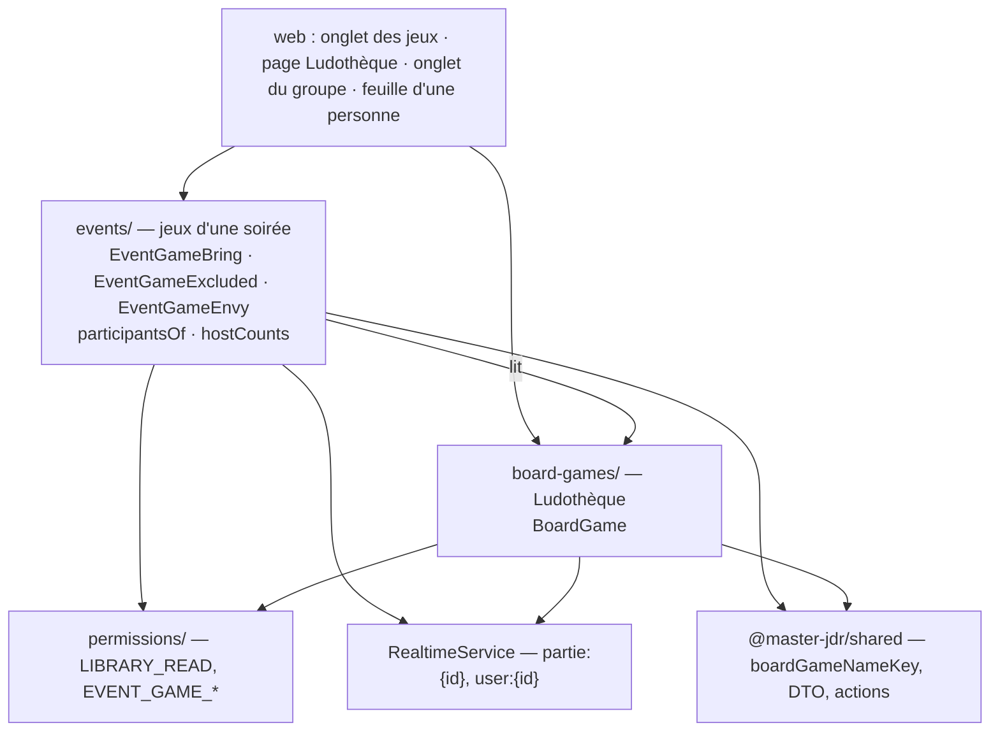
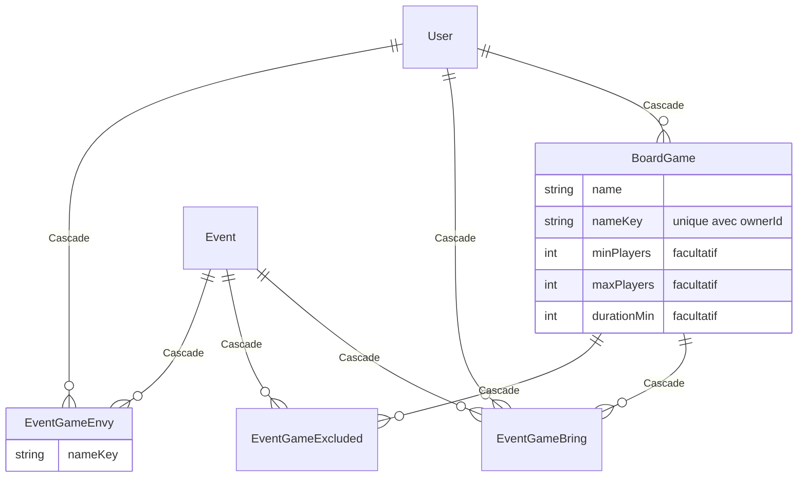

# Architecture Spine — Palier 10.5 : Jeux de société

Ce spine corrige trois points des documents amont, décidés avec l'utilisateur le 2026-10-29 et reportés le même jour dans le PRD et l'UX : **une soirée passée ou annulée n'affiche pas ses jeux** ; **une place réservée n'est pas une participation** ; **l'hôte ne change jamais** (P10-AD-5, P10-AD-17), donc FR-3 n'a pas de cas « changement d'hôte ».

## Design Paradigm

**NestJS Modular + Angular Signals (brownfield), trois couches et ports hérités du Palier 10 (P10-AD-1).** Ce palier ajoute un module de couche 2 et étend `events/` :

| Module | Couche | Écrit | Lit |
| --- | --- | --- | --- |
| `board-games/` (nouveau) | 2 — rassemblement | `BoardGame` (la Ludothèque) | `Membership` (émissions) |
| `events/` (étendu) | 2 — rassemblement | `EventGameBring`, `EventGameExcluded`, `EventGameEnvy` ; Compteur d'hôte (dérivé) | `BoardGame` |
| `permissions/` (étendu) | transverse | — | `Membership`, `Invitation`, `Partie`, `Event` |



Flèche = « peut dépendre de ». `board-games/` n'importe jamais `events/` : la dépendance va de `events/` vers `board-games/`.

## Inherited Invariants

Les AD du Palier 10 (**P10-AD-n**) et du Palier 10.4 (**P10.4-AD-n**) s'appliquent tels quels. Ceux que ce palier touche :

| Inherited | From parent | Binds here |
| --- | --- | --- |
| P10-AD-1 | Palier 10 | Une table, un écrivain ; pas d'import vers une couche au-dessus |
| P10-AD-5 | Palier 10 | `Event.ownerId` = l'hôte, immuable : les jeux de l'hôte sont ceux de `ownerId` |
| P10-AD-6 | Palier 10 | `PermissionService` seul juge — **étendu par AD-4** (cible `{ userId }`) ; ayants droit = une fonction dans `events/` (AD-3) |
| P10-AD-8 | Palier 10 | `RESERVED` = invitation non acceptée, pas une participation (AD-3) |
| P10-AD-11, P10-AD-17 | Palier 10 | Suppression de compte et départ : une procédure — **étendue par AD-6** |
| P10-AD-18, P10.4-AD-15 | Palier 10, 10.4 | Statut d'une partie / d'un événement : fonction pure partagée ; décide si une soirée est « à venir » (AD-5) |
| P7-AD-2, P7-AD-4 | Palier 7 | `emit(topic)` après validation, hors transaction ; `notifyChanged()` côté web |
| P9-AD-2, P9-AD-15 | Palier 9 | `pseudo` + `displayName`, jamais l'e-mail d'un tiers ; projection explicite vers les DTO |
| P9-AD-20 | Palier 9 | Sections, doublons, « jouable à N » et comptes dérivés côté écran à partir de la charge utile |

## Invariants & Rules

### AD-1 — La Ludothèque : une table, un écrivain, une clé de nom

- **Binds:** FR-1, FR-2, FR-6, FR-8
- **Prevents:** deux normalisations du nom qui ne reconnaissent pas les mêmes doublons ; un catalogue partagé qui réapparaît ; une Ludothèque écrite par `events/`.
- **Rule:** `BoardGame(id, ownerId, name, nameKey, minPlayers?, maxPlayers?, durationMin?, createdAt)`, écrivain **`board-games/`** seul, `@@unique([ownerId, nameKey])`, `ownerId → User` en `Cascade`. `nameKey = boardGameNameKey(name)`, **fonction unique** de `@master-jdr/shared` (espaces réduits, accents retirés, minuscules), calculée **à l'écriture par l'API** et servie dans tous les DTO ; le web regroupe sur le `nameKey` reçu et ne le recalcule jamais (sauf pré-contrôle facultatif de la saisie, avec la même fonction). Aucune identité de jeu entre deux personnes.

### AD-2 — Les jeux d'une soirée appartiennent à l'événement

- **Binds:** FR-3, FR-4, FR-5, FR-7
- **Prevents:** un Apport ou une Envie qui survit à une désinscription ; une table de soirée écrite par deux modules ; des Envies qui divergent entre les deux lignes d'un même jeu.
- **Rule:** Écrivain **`events/`** pour : `EventGameBring(eventId, boardGameId, userId)` unique `(eventId, boardGameId)` ; `EventGameExcluded(eventId, boardGameId)` unique ; `EventGameEnvy(eventId, userId, nameKey)` unique. `eventId → Event` et `boardGameId → BoardGame` en `Cascade`. Une Envie porte sur un **`nameKey`**, pas sur un exemplaire. Les jeux de l'hôte ne sont **jamais copiés** dans l'événement : ils se lisent dans la Ludothèque de `Event.ownerId`, moins les `EventGameExcluded`. Une Envie dont le `nameKey` n'est plus sur place est **ignorée à la lecture** ; quand une écriture d'`events/` retire la dernière source d'un `nameKey` (écarter, ne plus apporter), elle supprime ses Envies dans la même transaction.

### AD-3 — Participant : une fonction, à côté des votants

- **Binds:** FR-5, FR-6, FR-7
- **Prevents:** un « jouable à N » calculé sur une autre population que celle qui peut apporter ; une place réservée comptée comme une venue.
- **Rule:** `participantsOf(event)` dans `events/`, **seule définition**, lue par les refus d'écriture, par la projection (N) et par les tests : **groupe** → l'hôte + les `Inscription` `CONFIRMED` de la séance de l'événement ; **rencontre isolée** → les `Membership` de la partie (l'hôte et les invités qui ont accepté). `RESERVED` n'en fait jamais partie. N = sa taille.

### AD-4 — Lire une Ludothèque : une action, une cible personne [étend P10-AD-6]

- **Binds:** FR-8, FR-9
- **Prevents:** une règle de visibilité recodée dans `board-games/` ; l'énumération des Ludothèques d'inconnus ; une partie de JDR qui ouvrirait l'accès.
- **Rule:** `PermissionTarget` gagne `{ userId }` ; action **`LIBRARY_READ`**. Autorisé si lecteur = propriétaire, ou s'ils partagent une partie de **ralliement** où chacun est : membre (`Membership`), ou, pour une **rencontre isolée**, invité `PENDING` (`Invitation`). Une partie de JDR, une invitation déclinée ou un lien d'invitation non utilisé n'ouvrent rien. Refus = **404** (rien n'est révélé de l'existence du compte). Les lectures **de liste** (jeux sur place, Jeux du groupe) n'appellent pas `LIBRARY_READ` par personne : elles sont gardées par `PARTIE_READ` sur la partie et ne contiennent que les jeux de ses membres ou participants.

### AD-5 — Écrire sur une soirée : à venir, non annulée, droits nommés

- **Binds:** FR-4, FR-5, FR-7, FR-6
- **Prevents:** un Apport sur une soirée passée ; un invité qui écarte le jeu de l'hôte ; une soirée passée qui montre des jeux.
- **Rule:** Actions **`EVENT_GAME_BRING`**, **`EVENT_GAME_EXCLUDE`**, **`EVENT_GAME_ENVY`**, cible `{ eventId }`, ralliement seulement. `PermissionService` décide le rôle (membre ; hôte seul pour `EXCLUDE`, règle « hôte » existante) ; `events/` ajoute **sous le verrou de l'événement** (P10-AD-8) : soirée **à venir** (fonction de statut partagée) et non annulée ; appelant ∈ `participantsOf` ; `BRING` refusé à l'hôte et sur un jeu d'autrui ; `EXCLUDE` sur un jeu de l'hôte seulement. **Soirée passée, terminée ou annulée : la lecture des jeux renvoie une liste vide et le web n'affiche pas l'onglet** ; aucune copie de fin de soirée.

### AD-6 — Effacer les traces d'un départ, dans la procédure existante [étend P10-AD-17]

- **Binds:** FR-5, FR-7, FR-1
- **Prevents:** un Apport qui reste après une désinscription, un refus d'invitation ou un départ ; une suppression de jeu qui laisse des lignes orphelines.
- **Rule:** Toute sortie de `participantsOf` passe par un chemin d'`events/` qui supprime, **dans sa transaction**, les `EventGameBring` et `EventGameEnvy` de cette personne sur cet événement : désinscription, refus d'invitation, retrait d'une inscription, et `PartiesService.leave` (P10-AD-17, événements à venir). Supprimer un `BoardGame` supprime ses `EventGameBring` et `EventGameExcluded` par cascade ; supprimer un compte supprime sa Ludothèque par cascade (P10-AD-11 inchangé). Le passé n'est pas conservé (AD-5).

### AD-7 — Temps réel : la partie de chaque soirée touchée

- **Binds:** FR-6, FR-8, NFR temps réel
- **Prevents:** un onglet des jeux qui reste faux après un changement de Ludothèque ; deux modules qui choisissent des canaux différents.
- **Rule:** Après validation, hors transaction (P7-AD-2) : une écriture d'`events/` sur les jeux émet `partie:{partieId}` ; une écriture de **`board-games/`** émet `partie:{id}` pour **chaque partie de ralliement** dont le propriétaire est membre, et `user:{ownerId}`. Côté web, les services de l'onglet des jeux, des Jeux du groupe et de la Ludothèque exposent `notifyChanged()` et se rechargent sur ces signaux. Aucun nouveau canal.

### AD-8 — Compteur d'hôte : dérivé, jamais stocké

- **Binds:** FR-10
- **Prevents:** un compteur stocké qui dérive des événements ; deux définitions de « reçu ».
- **Rule:** Projection d'`events/` pour un groupe : par membre actuel, le nombre d'`Event` de la partie dont il est `ownerId`, **non annulés** et dont la plage est **passée** (fonction de statut partagée). Un ancien membre n'apparaît pas. Lu par `PARTIE_READ`.

## Consistency Conventions

| Concern | Convention |
| --- | --- |
| Noms | `BoardGame`, `nameKey`, `boardGameNameKey`, `minPlayers`, `maxPlayers`, `durationMin`, `EventGameBring`, `EventGameExcluded`, `EventGameEnvy`, `participantsOf`, `participantsCount`, `hostCounts` ; actions `LIBRARY_READ`, `EVENT_GAME_BRING`, `EVENT_GAME_EXCLUDE`, `EVENT_GAME_ENVY` ; synonymes interdits dans le code : `games/` (désigne déjà la partie), `ludotheque` en identifiant, `apport` en identifiant |
| Droits | `PermissionService.assert` à chaque écriture ; listes gardées par `PARTIE_READ` ; refus en français, 403 / 404 |
| Dérivé vs persisté | Persisté : `BoardGame`, `EventGameBring`, `EventGameExcluded`, `EventGameEnvy`. Dérivé : jeux sur place, sections, doublons ×N, « jouable à N », N, Compteur d'hôte, Jeux du groupe |
| Charge utile de l'onglet | Une lecture par soirée : jeux de l'hôte (non écartés ; écartés en plus pour l'hôte), Apports (avec `pseudo` / `displayName` du porteur), Envies (`nameKey`, `userId`), `participantsCount` ; « Dans mon … » se compose côté web depuis la Ludothèque du lecteur |
| Validation | `class-validator` : nom 1–80 caractères ; joueurs entiers 1–99, `max ≥ min` ; durée entière 1–1440 ; 500 jeux au plus par Ludothèque |
| Vocabulaire | Libellés par thème et `NEUTRAL_KEYS` d'EXPERIENCE.md §3 ; aucun mot du JDR |
| Temps réel | AD-7 |
| Tests | `boardGameNameKey` (casse, accents, espaces) ; matrice de refus `LIBRARY_READ` (groupe, isolée acceptée / en attente / déclinée, JDR, inconnu → 404) ; `EVENT_GAME_*` (non participant, hôte qui apporte, invité qui écarte, soirée passée, annulée, `RESERVED`) ; `participantsOf` ; traces effacées par chaque chemin d'AD-6 ; Envie purgée à la dernière source ; Compteur d'hôte (annulé, futur, ancien membre) |

## Stack

Inchangée par rapport au Palier 10.4 ; aucune dépendance nouvelle.

| Name | Version |
| --- | --- |
| Node.js | 24 LTS |
| pnpm | 11.8.0 |
| Angular | 22.1.3 |
| NestJS | 11.2.3 |
| Prisma (client + CLI) | 7.10.0 |
| PostgreSQL | 17 |

## Structural Seed

### Données (ajouts)



### Routes (ajouts)

| Route | Droit | Module |
| --- | --- | --- |
| `GET/POST /me/board-games`, `PATCH/DELETE /me/board-games/:id` | soi | `board-games/` |
| `GET /users/:userId/board-games` | `LIBRARY_READ` | `board-games/` |
| `GET /parties/:id/board-games` (Jeux du groupe, groupe seulement) | `PARTIE_READ` | `board-games/` |
| `GET /events/:eventId/board-games` (onglet) | `PARTIE_READ` | `events/` |
| `PUT/DELETE /events/:eventId/board-games/:boardGameId/bring` | `EVENT_GAME_BRING` | `events/` |
| `PUT/DELETE /events/:eventId/board-games/:boardGameId/exclusion` | `EVENT_GAME_EXCLUDE` | `events/` |
| `PUT/DELETE /events/:eventId/envies` (corps : `nameKey`) | `EVENT_GAME_ENVY` | `events/` |
| `GET /parties/:id/host-counts` (groupe seulement) | `PARTIE_READ` | `events/` |

### Source tree (ajouts)

```text
packages/shared/src/            # boardGameNameKey ; DTO BoardGame, EventBoardGames, HostCount ; 4 PermissionAction
apps/api/src/
  board-games/                  # nouveau : contrôleur /me, /users/:id, /parties/:id ; service ; émissions (AD-7)
  events/                       # participantsOf ; jeux d'une soirée ; nettoyage (AD-6) ; hostCounts
  permissions/                  # cible { userId }, LIBRARY_READ, EVENT_GAME_*
  parties/                      # leave() appelle le nettoyage d'events/ (AD-6)
apps/web/src/app/
  features/board-games/         # page Ludothèque (QuickAddRow), LibrarySheet
  features/events/              # onglet des jeux (GamesSummary, GamesSection, GameRow), onglets d'EventDialog
  features/parties/             # onglet Jeux du groupe, « Qui reçoit » dans Détails, onglet de la rencontre isolée
  core/theme/tones/             # libellés des trois thèmes ; NEUTRAL_KEYS
```

### Environnements et exploitation

Inchangés : Docker Compose (db, api, web, mailpit) ; aucun service, aucune variable, aucune tâche planifiée nouvelle. Migrations Prisma dans le conteneur, une par story qui introduit sa table ; pas de migration en plusieurs temps (P10-AD-16). Sécurité : checklist `docs/security.md` (validation des DTO, refus nommés, pas d'e-mail de tiers).

## Capability → Architecture Map

| Capability / Area | Lives in | Governed by |
| --- | --- | --- |
| FR-1, FR-2 Ludothèque | `board-games/`, web page Ludothèque | AD-1, AD-6, AD-7 |
| FR-3, FR-4 jeux de l'hôte, Jeu écarté | `events/`, web onglet | AD-2, AD-5 |
| FR-5 J'apporte | `events/`, web onglet | AD-2, AD-3, AD-5, AD-6 |
| FR-6 jeux sur place, ×N, jouable à N | `events/` (lecture), web (dérivation) | AD-2, AD-3, AD-5, AD-7 |
| FR-7 Envie | `events/`, web | AD-2, AD-5 |
| FR-8 Jeux du groupe | `board-games/`, web onglet du groupe | AD-1, AD-4 |
| FR-9 Ludothèque d'une personne | `permissions/`, `board-games/`, web `LibrarySheet` | AD-4 |
| FR-10 Compteur d'hôte | `events/`, web Détails | AD-8 |

## Open Questions

Aucune. Les trois corrections ont été reportées le 2026-10-29 dans le PRD (Glossaire « Participant », FR-1, FR-3, FR-6, §9) et dans EXPERIENCE.md (§2.3, §5.1).

## Deferred

- **Import d'un catalogue (BoardGameGeek)** : écarté par le PRD.
- **Suivi de prêt** : évolution future (PRD §6.2).
- **Envie hors d'une soirée** : selon SM-2.
- **Purge des Envies orphelines** : inutile tant que la lecture les ignore (AD-2).
- **Historique des jeux d'une soirée passée** : non conservé (AD-5) ; à rouvrir si le besoin apparaît.
- **Déploiement de production** : Palier 11.
