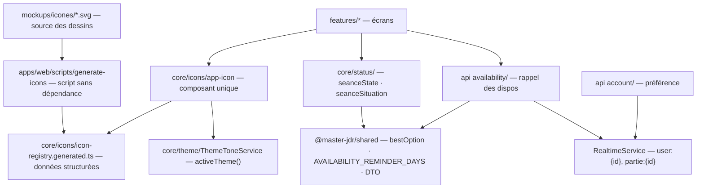

# Architecture Spine — Paliers 10.6 à 10.8

Ce spine **amende le PRD (FR-14) et l'UX (§4.3, §4.1)** sur trois points décidés avec l'utilisateur le 2026-11-01 :
- la page d'une partie n'affiche pas de bannière illustrée (son en-tête est le bandeau texte du Shell) : « Changer / Retirer » la couverture se place **en tête de l'onglet Détails**, sur une bannière illustrée (AD-8) ;
- **pas d'« Annuler »** après un changement de couverture, l'API supprimant l'ancienne image : « Changer » enregistre aussitôt, « Retirer » demande une confirmation (AD-8) ;
- « J'y étais » et « Je participe » d'une séance **sans inscriptions** valent pour les **joueurs actuels** de la partie, faute d'historique d'appartenance (AD-6).

## Design Paradigm

**NestJS Modular + Angular Signals (brownfield), trois couches et ports hérités du Palier 10 (P10-AD-1).** Ce palier est surtout du web. Côté serveur, il ne touche que les dispos et les préférences du compte.

| Zone | Côté | Écrit | Lit |
| --- | --- | --- | --- |
| `availability/` (étendu) | API | — | `AvailabilityDeclaration`, `Membership`, `User.availabilityReminder` |
| `account/` (étendu) | API | `User.availabilityReminder` | — |
| `core/icons/` (nouveau) | web | — | registre généré, `ThemeToneService.activeTheme()` |
| `core/status/` (étendu) | web | — | `SeanceDto`, `SessionPollDto`, `bestOption` |
| `features/calendar/` (étendu) | web | état d'écran du calendrier | — |
| `features/parties/`, `features/scenarios/` (étendus) | web | — | fonctions de `core/status/`, `PartiesService` |



Flèche = « peut dépendre de » (ou « produit », pour la chaîne de génération). `core/icons/` ne dépend d'aucune `feature`.

## Inherited Invariants

Les AD des Paliers 7, 9, 10, 10.4 et 10.5 s'appliquent tels quels. Ceux que ce palier touche :

| Inherited | From parent | Binds here |
| --- | --- | --- |
| P10-AD-1 | Palier 10 | Une table, un écrivain ; pas d'import vers une couche au-dessus (`account/` écrit la préférence, `availability/` la lit) |
| P10-AD-6 | Palier 10 | `PermissionService` seul juge : la couverture reste gardée par `PARTIE_COVER_UPDATE` (AD-8) |
| P10-AD-18, P10.4-AD-15 | Palier 10, 10.4 | Statut d'une partie : fonction pure partagée ; décide « partie active » pour le rappel (AD-5) |
| P7-AD-2, P7-AD-4 | Palier 7 | `emit(topic)` après validation, hors transaction ; `notifyChanged()` côté web (AD-5, AD-6) |
| P9-AD-20 | Palier 9 | Comptes, sections et états d'écran dérivés côté web depuis la charge utile (AD-6) |
| `bestOption` (Story 44.3) | Palier 10.4 | Seule définition du meilleur créneau (AD-6) |

## Invariants & Rules

### AD-1 — Une icône = un nom, un composant, un registre de données

- **Binds:** FR-6, FR-7, FR-8, FR-9
- **Prevents:** deux façons de dessiner une icône (composants épars, `<mat-icon>`, chaînes HTML) ; une chaîne SVG injectée via `[innerHTML]`, qu'Angular assainit en retirant le SVG et qui pousserait à `bypassSecurityTrustHtml` ; un nom d'icône libre qui casse en silence.
- **Rule:** Toute icône de l'application passe par **un seul composant** `<app-icon name="…">` de `core/icons/`. Il lit le **registre généré** `icon-registry.generated.ts` : pour chaque nom, des **données structurées** (`viewBox` et liste d'éléments `{ tag, attrs }`, `tag` ∈ `path | circle | ellipse | rect | line | polyline | polygon`) rendues par le template du composant avec des liaisons d'attributs. **Interdits** : `[innerHTML]` pour une icône, `DomSanitizer.bypassSecurityTrust*`, `MatIconRegistry`, chargement réseau d'une icône. `name` est typé par l'union `IconName` générée ; un nom inconnu est une erreur de compilation. Les SVG de logo, bande de marque, bannière, badges de système et icône de création restent hors de ce registre.

### AD-2 — Le registre est généré, jamais écrit à la main

- **Binds:** FR-6, FR-7
- **Prevents:** un registre qui diverge des dessins validés ; une retouche de dessin faite dans le TS et perdue au prochain dessin ; une nouvelle dépendance pour parser du SVG.
- **Rule:** Source de vérité : les fichiers SVG retenus par l'UX (`ux-jdr-master-2026-10-31/mockups/icones/{grimoire-emeraude,foret-ancienne,atelier-cuivre,communes}/*.svg`), recopiés au démarrage du palier dans `apps/web/src/assets-src/icons/` qui devient la source vivante. Le script `apps/web/scripts/generate-icons.mjs` (**Node seul, sans dépendance**, lancé dans le conteneur `web`) produit `icon-registry.generated.ts` et l'union `IconName`. Le fichier généré porte un en-tête « généré, ne pas modifier » et est commité. Le script refuse un SVG qui contient `id`, `mask`, `clipPath`, `style`, `script`, `href` ou une balise hors de la liste d'AD-1.

### AD-3 — Thème et niveau : le nom ne change pas, le dessin si

- **Binds:** FR-6, FR-7, FR-8
- **Prevents:** un écran qui choisit lui-même le dessin d'un thème ; des noms différents d'un thème à l'autre ; un flash au changement de thème.
- **Rule:** Les **icônes de sens** ont le même nom dans les trois thèmes (`nav-parties`, `role-mj`, `favori-pose`…) ; le registre en garde trois dessins et `app-icon` choisit celui de `ThemeToneService.activeTheme()` (signal, sans rechargement). Les **icônes utilitaires** (`fermer`, `telecharger`…) n'ont qu'un dessin. Les deux niveaux partagent un seul espace de noms ; un écran ne lit jamais `activeTheme()` pour choisir une icône. Accessibilité : `app-icon` est `aria-hidden` par défaut ; un `label` d'entrée (texte tiré du ton) le rend `role="img"` avec `aria-label`.

### AD-4 — La police Material ne part qu'une fois la migration finie

- **Binds:** FR-6, NFR icônes
- **Prevents:** une icône qui disparaît (carré vide) parce que la police a été retirée trop tôt ; un `<mat-icon>` réintroduit après la migration.
- **Rule:** La migration avance par zone d'écran ; tant qu'elle n'est pas finie, `<mat-icon>` et `app-icon` cohabitent. La **dernière** story du 10.7 retire le `<link>` Material Icons d'`apps/web/src/index.html` et tous les imports de `MatIconModule`, et ajoute un test qui échoue si un gabarit contient `<mat-icon` ou si `index.html` charge `Material+Icons`. Les fonctions qui calculent aujourd'hui un nom Material (`roleIcon`, `tintIcon`, `modeIcon`, favori) renvoient un `IconName` ; le rôle passe par **une seule** fonction `roleIconName(role)` de `core/icons/` (`mj` → `role-mj`, `player` et membre de ralliement → `role-joueur`, `admin` → `role-admin` ; `role-hote` pour l'hôte d'une soirée). **Ordre** : la story socle (`app-icon`, script, registre) précède toute story qui ajoute une icône, 10.6 comprise ; dès qu'elle est livrée, aucun nouveau `<mat-icon>` n'entre dans le code.

### AD-5 — Rappel des dispos : une règle serveur, une préférence de compte

- **Binds:** FR-4, FR-5
- **Prevents:** deux définitions de « rien de déclaré » (serveur et client) ; un rappel compté une fois par partie ; une préférence perdue en changeant d'appareil ; un rappel qui ne disparaît pas après une déclaration.
- **Rule:** `AvailabilityService.reminderDue(userId)`, **seule définition**, vrai si et seulement si : `User.availabilityReminder` est vrai **et** l'utilisateur est membre d'au moins une partie **active**, de JDR ou de ralliement — savoir lu par un **port** `ActivePartiesPort.hasActivePartie(userId)` déclaré dans `availability/` et implémenté par la couche qui calcule l'avancement (P10-AD-1 : `availability/` n'importe pas `events/` ni `parties/`) — **et** aucune de **ses propres** `AvailabilityDeclaration` non expirées ne recouvre les `AVAILABILITY_REMINDER_DAYS` (constante de `@master-jdr/shared`, 28) jours à venir, selon le filtre de recouvrement existant (récurrences comprises ; indisponibilités synthétiques des séances exclues). Exposé par `GET /me/availability-reminder` → `{ show: boolean }`, distinct de `GET /me/party-signals`. Préférence : `User.availabilityReminder Boolean @default(true)` (migration additive), écrite par `PATCH /me/preferences` (`@IsBoolean`), renvoyée dans `AuthUser`. Temps réel : toute écriture d'une déclaration et tout changement de cette préférence émettent `user:{userId}` en plus des émissions existantes ; côté web, `AvailabilityReminderService` (`core/availability/`) expose `notifyChanged()` et s'inscrit au préfixe `user:` du `RealtimeService`, ce qui couvre aussi l'acceptation d'une invitation et la sourdine faite sur un autre appareil. Coût assumé : cette émission réveille les autres gestionnaires `user:` (relecture du calendrier personnel comprise) ; pas d'émission plus fine à ce palier. Le passage du temps est recalculé à chaque lecture, sans tâche planifiée. Le rappel ouvre le calendrier personnel en mode déclaration par `?declarer=1` (AD-7).

### AD-6 — « Ma situation » : une fonction pure côté web, le meilleur créneau partagé

- **Binds:** FR-10, FR-11, FR-12
- **Prevents:** une pastille calculée différemment sur la carte et dans la fiche ; un badge d'état qui porte encore la situation personnelle ; un meilleur créneau recalculé à la main.
- **Rule:** `seanceSituation(seance, viewerId, isMj, todayKey)` dans `core/status/`, à côté de `seanceState`, **seule définition**, utilisée par les cartes de chapitres, la Chronologie, la fiche de scénario **et le widget « Prochaine séance » de la page d'une partie** (aujourd'hui consommateur de `answer_poll`, `partie-detail.ts:835`). La séance d'un chapitre que reprend sa carte est donnée par **une seule** fonction `nextSeanceOf(scenario, todayKey)` de `core/status/`.
  - Valeurs : `je_mene` (MJ) · `vote_a_faire` · `j_ai_vote` · `je_participe` · `pas_inscrit` · `j_y_etais` · `null` (aucune pastille).
  - Séance **à inscriptions** : `je_participe` / `j_y_etais` pour les inscrits seulement. Séance **sans inscriptions** (à vote, ou datée directement) : `je_participe` puis `j_y_etais` pour les **joueurs actuels** de la partie.
  - Cas `null` : séance passée sans participation, vote clos sans réponse, séance à dater sans vote, chapitre sans séance à venir.
  - `seanceState` ne renvoie plus de valeur personnelle (`answer_poll` disparaît, avec sa clé de ton et ses tests).
  - Vote en résumé : dénominateur, règle « a répondu » et liste des absents **identiques à la Destinée** (`eligibleCount`, `hasAnswered`, `getMissingVoters`) ; meilleur créneau par `bestOption` de `@master-jdr/shared`, via **un seul** adaptateur `SessionPollDto` → `RankableOption` ; « Fixer la date… » réutilise `SealConfirmDialog`.
  - La pastille est **un seul** composant `shared/situation-pill`, utilisé aussi par la carte d'événement (qui perd son balisage en ligne).
  - Aucun changement d'API : tout se dérive de `SeanceDto` et `SessionPollDto` ; « qui n'a pas répondu » s'affiche en noms pour le MJ et en nombre pour les joueurs (règle d'écran, la charge utile est inchangée). Rafraîchi par `partie:{id}` existant.

### AD-7 — Le calendrier a un seul mode à la fois

- **Binds:** FR-1, FR-2, FR-3
- **Prevents:** le mode déclaration, le Composer et la Destinée allumés en même temps par des booléens indépendants ; une barre de sélection qui ne sait pas à quel mode elle appartient.
- **Rule:** `calendar-view` porte **un** signal `interaction: 'lecture' | 'declaration' | 'composer' | 'destinee'` (le nom `mode` y désigne déjà le calendrier personnel ou MJ), écrit **seulement** par `setInteraction()` ; il remplace le booléen `composing`, et `destinyPollId` ne dit plus que *quel* sondage. Allumer une interaction éteint l'autre et vide la sélection en cours.
  - URL : l'interaction n'est pas persistée ; seules exceptions, l'ouverture directe en Destinée (`?poll=`, P10.4) et `?declarer=1` (rappel des dispos), **lus une fois puis retirés** de l'URL.
  - La **sélection** reste dans les vues Mois et Semaine ; elles lisent `interaction` : en `declaration`, un tap sélectionne ; en `lecture`, un tap lit et l'appui long ou le glissement ouvrent la sélection comme aujourd'hui (Story 36.3, AC15 à AC17), sans changer `interaction`.
  - `Échap` : la vue vide d'abord sa sélection ; si elle est vide, elle demande à `calendar-view` de repasser en `lecture`.
  - La barre de sélection lit `interaction` pour savoir si elle colle au bas de l'écran (`declaration`).
  - Les déclarations passent par les points d'accès existants de `availability/`.

### AD-8 — Onglets par clé ; couverture en tête de l'onglet Détails

- **Binds:** FR-13, FR-14
- **Prevents:** un accès direct (« + Inviter ») qui ouvre le mauvais onglet après le réordonnancement ; un second chemin d'envoi de couverture qui contourne la permission ou la garde anti-double-clic.
- **Rule:** Les onglets de `partie-detail` sont identifiés par une **clé** (`chapitres`, `chronologie`, `details`, `fiches`, `invitations`, `homme-dragon`, `scenario`…) ; l'état est `selectedTabKey` (fini `manualTabIndex`), et l'index ne se calcule qu'au rendu depuis la liste des onglets rendus. Les trois index en dur d'aujourd'hui (`MJ_INVITATIONS_TAB_INDEX`, `defaultTabIndex`, le lien vers une annonce qui force Détails) passent par des clés. Onglet par défaut et ordre selon EXPERIENCE §4.2.
  - Couverture : un composant `editable-banner` en tête de l'onglet Détails enveloppe `PartyBanner` (qui reste purement présentationnelle) et appelle `PartiesService.setCoverImage` / `removeCoverImage`.
  - Droit : `PartieDto` gagne un drapeau **calculé par le serveur** `can.coverUpdate` (`PermissionService`, `PARTIE_COVER_UPDATE`) ; le web n'en déduit jamais le droit du rôle.
  - La logique d'envoi (taille, garde anti-double-clic) vit dans **une seule** unité `core/parties/cover-upload.ts`, utilisée par `partie-form` et `editable-banner`.
  - « Changer » enregistre aussitôt, sans « Annuler » ; « Retirer » demande une confirmation. Rafraîchi par `partie:{id}` existant. Vaut pour les deux modes.

## Consistency Conventions

| Concern | Convention |
| --- | --- |
| Noms | `app-icon`, `IconName`, `roleIconName`, `icon-registry.generated.ts`, `generate-icons.mjs` ; noms d'icônes en kebab-case français (`nav-parties`, `role-hote`, `dispo-non`) ; `reminderDue`, `availabilityReminder`, `AVAILABILITY_REMINDER_DAYS`, `ActivePartiesPort`, `AvailabilityReminderService` ; `seanceSituation`, `nextSeanceOf` et les valeurs de situation en snake_case ; `situation-pill` ; `interaction` et `setInteraction()` du calendrier ; `selectedTabKey` ; `editable-banner`, `cover-upload` ; `can.coverUpdate` |
| Libellés | Tout nouveau texte (bandeau, rappel, pastilles, snackbars, encadré de situation, résumé) est une clé des **trois** fichiers de ton ; tutoiement en Forêt ; exceptions identiques partout listées en EXPERIENCE §1. Pastilles : clés `situation.<valeur>` partagées par la carte d'événement et la séance (les clés de pastille propres à la carte d'événement y migrent) ; une clé retirée l'est des trois fichiers et de leurs tests |
| Couleurs | Uniquement les variables `--jdr-*` du thème ; « Vote à faire » en `--jdr-status-todo` sur la carte d'événement comme sur la séance |
| Temps réel | AD-5 (`user:{id}` pour le rappel) ; AD-6 (`partie:{id}` existant) ; aucun nouveau canal |
| Dérivé vs persisté | Persisté : `User.availabilityReminder`. Dérivé : rappel, « Ma situation », état de séance, résumé du vote, interaction du calendrier, onglet par défaut, `can.coverUpdate` |
| Tests | `reminderDue` (préférence, aucune partie active, récurrence qui couvre, déclaration expirée, synthétique exclue, borne des 28 jours) ; `seanceSituation` et `nextSeanceOf` (chaque valeur et chaque cas `null`, séance avec ou sans inscriptions) ; `seanceState` sans valeur personnelle ; widget « Prochaine séance » ; générateur (refus des balises et attributs interdits) ; `app-icon` (changement de thème, nom accessible) ; `roleIconName` ; test « plus de `<mat-icon>` » en fin de 10.7 ; ouverture d'un onglet par clé (dont « + Inviter » et lien d'annonce) ; `interaction` exclusive et `?declarer=1` retiré de l'URL ; `can.coverUpdate` (MJ, hôte, admin, joueur, membre) |

## Stack

Inchangée (Angular 22, NestJS 11, Prisma 7, PostgreSQL 17, Node 24, pnpm 11.8). **Aucune nouvelle dépendance.** Retrait : la police Material Icons chargée depuis Google Fonts (AD-4).

## Structural Seed

```text
apps/web/
  scripts/generate-icons.mjs           # AD-2 — lit assets-src/icons, écrit le registre
  src/assets-src/icons/                 # source vivante des SVG (copie initiale de l'UX)
    grimoire-emeraude/ foret-ancienne/ atelier-cuivre/ communes/
  src/app/core/icons/
    app-icon.ts                         # AD-1, AD-3
    icon-registry.generated.ts          # AD-2 — généré, commité
  src/app/core/status/
    status-derivation.ts                # seanceState (impersonnel) + seanceSituation (AD-6)
  src/app/features/calendar/calendar-view/   # signal interaction (AD-7)
  src/app/features/parties/editable-banner/  # AD-8
  src/app/core/parties/cover-upload.ts       # AD-8 — envoi partagé avec partie-form
  src/app/core/availability/                 # AvailabilityReminderService (AD-5)
  src/app/shared/situation-pill/             # AD-6
apps/api/src/
  availability/availability.service.ts  # reminderDue (AD-5)
  account/                              # PATCH /me/preferences + availabilityReminder
  prisma/schema.prisma                  # User.availabilityReminder Boolean @default(true)
packages/shared/src/index.ts            # AVAILABILITY_REMINDER_DAYS, DTO du rappel
```

Environnements et déploiement : inchangés ; une migration Prisma additive (colonne avec valeur par défaut, sans reprise de données).

## Capability → Architecture Map

| Capability / Area | Lives in | Governed by |
| --- | --- | --- |
| FR-1 à FR-3 — mode déclaration | `features/calendar/` | AD-7 |
| FR-4, FR-5 — rappel et sourdine | `api availability/`, `api account/`, tableau de bord, page Compte | AD-5 |
| FR-6 à FR-9 — icônes | `core/icons/`, `scripts/`, tous les écrans | AD-1 à AD-4 |
| FR-10 — « Ma situation » | `core/status/`, cartes de chapitres et Chronologie | AD-6 |
| FR-11, FR-12 — fiche et vote en résumé | `features/scenarios/` (`seance-list`, fiche) | AD-6 |
| FR-13 — onglets | `features/parties/partie-detail` | AD-8 |
| FR-14 — couverture | `features/parties/editable-banner`, onglet Détails | AD-8, P10-AD-6 |

## Open Questions

- Avant la story qui retire la police (AD-4) : vérifier qu'aucun composant Angular Material utilisé (sélecteurs, dates, puces…) ne dépend de la police Material Icons.

## Deferred

- **Ordre des stories de migration des icônes** : par zone d'écran, décidé aux épics ; seule la dernière étape est fixée (AD-4).
- **Mise en cache ou découpage du registre par thème** : inutile au volume actuel (~130 icônes) ; à revoir si le registre dépasse une taille qui pèse sur le premier chargement.
- **Favicon et logo** : hors du jeu d'icônes, inchangés.
- **Notification ou e-mail du rappel des dispos** : hors périmètre (PRD).
